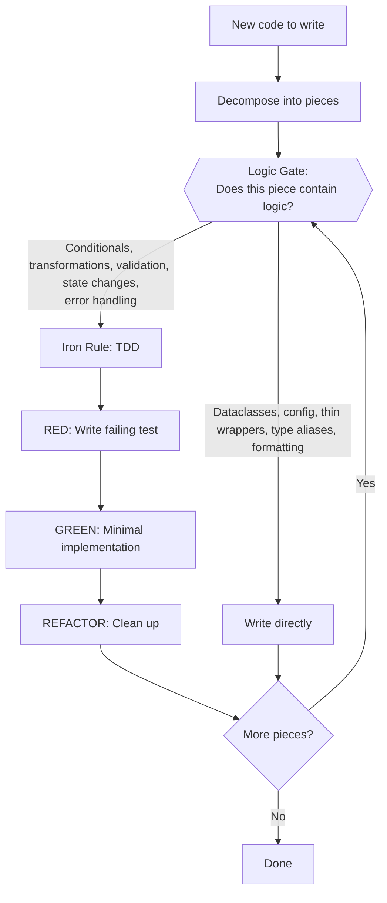

# Test-Driven Development (TDD)

**References:** @testing-anti-patterns.md — load when writing tests, adding mocks, or reviewing test code.

## Contents

1. [The Two Gates](#the-two-gates) — Logic Gate + Iron Rule decision model
2. [Gate 1: The Logic Gate](#gate-1-the-logic-gate) — Triage what needs tests
3. [Gate 2: The Iron Rule](#gate-2-the-iron-rule) — Strict TDD for logic
4. [Red-Green-Refactor](#red-green-refactor) — The cycle
5. [Good Tests](#good-tests) — Quality attributes
6. [Why Order Matters](#why-order-matters) — Rebuttals to common objections
7. [Common Rationalizations](#common-rationalizations) — Quick reference table
8. [Example: Bug Fix](#example-bug-fix) — Logic Gate + TDD walkthrough
9. [Verification Checklist](#verification-checklist) — Before marking complete
10. [When Stuck](#when-stuck) — Troubleshooting
11. [Debugging Integration](#debugging-integration) — Bug fix workflow

## The Two Gates

Before writing any code, pass it through two gates:

1. **The Logic Gate** — Triage. Does this piece contain logic?
2. **The Iron Rule** — For everything that passes the Logic Gate, strict TDD applies.



## Gate 1: The Logic Gate

Decompose the work into its constituent pieces. For each piece, ask: **does this contain logic?**

**Passes the Logic Gate (requires TDD):**
- Conditionals and branching
- Data transformations and computations
- Validation and parsing
- State management and transitions
- Error handling with recovery logic
- Business rules and domain logic
- Algorithm implementations

**Does NOT pass the Logic Gate (write directly):**
- Dataclasses, NamedTuples, TypedDicts (pure data declarations)
- Type aliases and protocol definitions
- Configuration and constants
- Thin wrappers that only delegate (no branching, no transformation)
- Plot formatting and visual styling
- Boilerplate (`__init__.py`, module-level setup)
- String templates and static content

**When in doubt:** If you can't point to a conditional, transformation, or state change, it probably doesn't pass the Logic Gate.

### Triage Output

Before writing code, briefly identify what passes and what doesn't:
- "These pieces contain logic and need TDD: X, Y"
- "These are declarations/glue and can be written directly: Z"

## Gate 2: The Iron Rule

```
NO LOGIC WITHOUT A FAILING TEST FIRST
```

For code that passes the Logic Gate: write the test first, watch it fail, write minimal code to pass.

If logic is written before its test:
1. Stop — the test you write now can only describe what you already wrote, not verify intended behavior
2. Delete the logic and restart test-first
3. This applies to logic specifically, not declarations

## Red-Green-Refactor

### RED - Write Failing Test

Write one minimal test showing what should happen.

<Good>
```python
def test_retries_failed_operations_3_times():
    attempts = []

    def operation():
        attempts.append(1)
        if len(attempts) < 3:
            raise Exception('fail')
        return 'success'

    result = retry_operation(operation)

    assert result == 'success'
    assert len(attempts) == 3
```
Clear name, tests real behavior, one thing
</Good>

<Bad>
```python
def test_retry_works():
    mock = Mock()
    mock.side_effect = [
        Exception('fail'),
        Exception('fail'),
        'success'
    ]
    retry_operation(mock)
    assert mock.call_count == 3
```
Vague name, tests mock not code
</Bad>

**Requirements:**
- One behavior
- Clear name
- Real code (no mocks unless unavoidable)

### Verify RED - Watch It Fail

**MANDATORY. Never skip.**

```bash
pytest path/to/test_module.py::test_name -v
```

Confirm:
- Test fails (not errors)
- Failure message is expected
- Fails because feature missing (not typos)

**Test passes?** You're testing existing behavior. Fix test.

**Test errors?** Fix error, re-run until it fails correctly.

### GREEN - Minimal Code

Write simplest code to pass the test.

<Good>
```python
def retry_operation(fn):
    for i in range(3):
        try:
            return fn()
        except Exception as e:
            if i == 2:
                raise
```
Just enough to pass
</Good>

<Bad>
```python
def retry_operation(
    fn,
    max_retries: int = 3,
    backoff: str = 'linear',
    on_retry: callable = None
):
    # YAGNI
    pass
```
Over-engineered
</Bad>

Don't add features, refactor other code, or "improve" beyond the test.

### Verify GREEN - Watch It Pass

**MANDATORY.**

```bash
pytest path/to/test_module.py::test_name -v
```

Confirm:
- Test passes
- Other tests still pass
- Output pristine (no errors, warnings)

**Test fails?** Fix code, not test.

**Other tests fail?** Fix now.

### REFACTOR - Clean Up

After green only:
- Remove duplication
- Improve names
- Extract helpers

Keep tests green. Don't add behavior.

### Repeat

Next failing test for next feature.

## Good Tests

| Quality | Good | Bad |
|---------|------|-----|
| **Minimal** | One thing. "and" in name? Split it. | `test('validates email and domain and whitespace')` |
| **Clear** | Name describes behavior | `test('test1')` |
| **Shows intent** | Demonstrates desired API | Obscures what code should do |

## Why Order Matters

**"I'll write tests after to verify it works"**

Tests written after code pass immediately. Passing immediately proves nothing:
- Might test wrong thing
- Might test implementation, not behavior
- Might miss edge cases you forgot
- You never saw it catch the bug

Test-first forces you to see the test fail, proving it actually tests something.

**"I already manually tested all the edge cases"**

Manual testing is ad-hoc. You think you tested everything but:
- No record of what you tested
- Can't re-run when code changes
- Easy to forget cases under pressure
- "It worked when I tried it" ≠ comprehensive

Automated tests are systematic. They run the same way every time.

**"Tests after achieve the same goals - it's spirit not ritual"**

No. Tests-after answer "What does this do?" Tests-first answer "What should this do?"

Tests-after are biased by your implementation. You test what you built, not what's required. You verify remembered edge cases, not discovered ones.

Tests-first force edge case discovery before implementing. Tests-after verify you remembered everything (you didn't).

## Common Rationalizations

| Excuse | Reality |
|--------|---------|
| "Too simple to test" | If it has logic (conditionals, transforms), test it. If it's a declaration, the Logic Gate says skip it. |
| "I'll test after" | Tests passing immediately prove nothing. |
| "Tests after achieve same goals" | Tests-after = "what does this do?" Tests-first = "what should this do?" |
| "Already manually tested" | Ad-hoc ≠ systematic. No record, can't re-run. |
| "Deleting X hours is wasteful" | Sunk cost fallacy. Keeping unverified logic is technical debt. |
| "Keep as reference, write tests first" | You'll adapt it. That's testing after. Delete means delete. |
| "Need to explore first" | Fine. Throw away exploration, start with TDD. |
| "Test hard = design unclear" | Listen to test. Hard to test = hard to use. |
| "This doesn't need tests" | Apply the Logic Gate. If it has logic, it does. If it's a declaration, it doesn't. |

## Red Flags - STOP and Start Over

For code that passed the Logic Gate:
- Logic written before test
- Test passes immediately on first run
- Can't explain why test failed
- Rationalizing "just this once"

**All of these mean: Delete the logic. Start over with TDD.**

## Example: Bug Fix

**Bug:** Empty email accepted

**Logic Gate:** Email validation has conditionals → passes the gate → TDD.

**RED**
```python
def test_rejects_empty_email():
    result = submit_form({'email': ''})
    assert result['error'] == 'Email required'
```

**Verify RED**
```bash
$ pytest
FAILED: AssertionError: expected 'Email required', got None
```

**GREEN**
```python
def submit_form(data):
    email = data.get('email', '').strip()
    if not email:
        return {'error': 'Email required'}
    # ...
```

**Verify GREEN**
```bash
$ pytest
PASSED
```

**REFACTOR**
Extract validation for multiple fields if needed.

## Verification Checklist

Before marking work complete:

- [ ] Logic Gate triage was performed
- [ ] Every piece containing logic has a test
- [ ] Watched each test fail before implementing
- [ ] Each test failed for expected reason (feature missing, not typo)
- [ ] Wrote minimal code to pass each test
- [ ] All tests pass
- [ ] Output pristine (no errors, warnings)
- [ ] Tests use real code (mocks only if unavoidable)
- [ ] Edge cases and errors covered for logic

## When Stuck

| Problem | Solution |
|---------|----------|
| Don't know what needs tests | Apply the Logic Gate. Decompose, classify, test the logic. |
| Don't know how to test | Write wished-for API. Write assertion first. Ask your human partner. |
| Test too complicated | Design too complicated. Simplify interface. |
| Must mock everything | Code too coupled. Use dependency injection. |
| Test setup huge | Extract helpers. Still complex? Simplify design. |

## Debugging Integration

Bug found? Write failing test reproducing it. Follow TDD cycle. Test proves fix and prevents regression.

Never fix bugs without a test.

## References

- **testing-anti-patterns.md** — What to avoid when writing tests: mocking pitfalls, production pollution, incomplete mocks. Load when adding mocks or reviewing test code.
